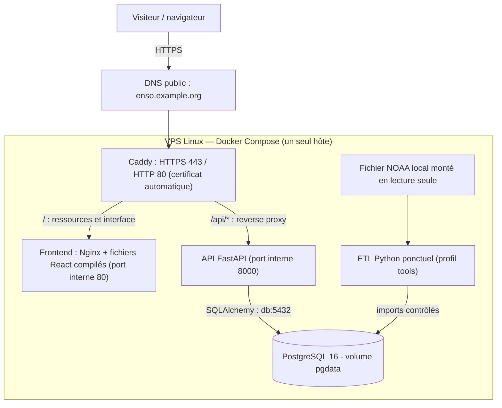

# Déploiement cible — ENSO Monitor (issue #19)

> **Statut : architecture cible documentée, non déployée et non validée sur un VPS public.**
> **Déploiement réel facultatif, aucune dépense.** Les exemples ci-dessous sont destinés à la **section 7 du dossier de conception PDF** ; ils ne remplacent pas la configuration locale `compose.yaml` déjà testée.

## 7.1 Besoin, alternatives, choix et vérification

**Besoin.** Rendre le graphique ONI accessible en HTTPS, conserver les données PostgreSQL et permettre de reproduire les imports NOAA sans exposer directement les services internes.

**Alternatives.** Un hébergement séparé (frontend statique, API et base managée) faciliterait l'évolution mais multiplierait les services et les coûts potentiels ; un VPS unique réduit la complexité du MVP mais concentre les risques.

**Choix.** VPS Linux + Docker Compose + Caddy (HTTPS et reverse proxy) + frontend React compilé servi par Nginx + FastAPI + PostgreSQL 16 dans un volume persistant. L'ETL fonctionne en tâche ponctuelle, non en service public permanent.

**Limites.** Architecture mono-serveur sans haute disponibilité (HA) ni reprise automatique sur une autre machine. Un volume Docker ne constitue pas une sauvegarde. Les exemples sont à adapter (nom de domaine, accès SSH, stockage, secrets, supervision) et à tester avant toute mise en ligne.

**Vérification prévue.** Résolution DNS, certificat HTTPS valide, `GET /api/v1/health`, requête ONI, migration Alembic, persistance après redémarrage, restauration d'une sauvegarde sur une base de test et vérification de l'absence de ports PostgreSQL/API publiés.

## 7.2 Schéma d'architecture cible



**Commentaire.** Caddy est le seul point d'entrée HTTP(S) public : il transmet les requêtes `/api/*` à FastAPI et le reste au frontend Nginx. La base PostgreSQL et l'ETL restent sur le réseau Docker interne ; le volume `pgdata` maintient les données lors d'un redémarrage des conteneurs. Les certificats et l'état de Caddy sont également conservés dans des volumes dédiés.

## 7.3 Extrait illustratif d'un Compose de production

Cet extrait est **un exemple d'architecture**, pas un fichier `compose.yaml` prêt à déployer sans adaptation ni tests. Il suppose que les Dockerfiles actuels produisent une image API exécutable et une image frontend Nginx, et que les variables PostgreSQL sont renseignées dans un fichier `.env` **non versionné**. Le domaine `enso.example.org` est fictif ; utiliser un domaine réellement contrôlé pour obtenir un certificat TLS.

```yaml
services:
  db:
    image: postgres:16-alpine
    restart: unless-stopped
    environment:
      POSTGRES_USER: ${POSTGRES_USER:?required}
      POSTGRES_PASSWORD: ${POSTGRES_PASSWORD:?required}
      POSTGRES_DB: ${POSTGRES_DB:?required}
    volumes:
      - pgdata:/var/lib/postgresql/data
    healthcheck:
      test: ["CMD-SHELL", 'pg_isready -U "$$POSTGRES_USER" -d "$$POSTGRES_DB"']
      interval: 5s
      timeout: 5s
      retries: 10
    # Aucun port publié sur l'hôte.

  api:
    build: ./api
    restart: unless-stopped
    environment:
      POSTGRES_USER: ${POSTGRES_USER:?required}
      POSTGRES_PASSWORD: ${POSTGRES_PASSWORD:?required}
      POSTGRES_DB: ${POSTGRES_DB:?required}
      POSTGRES_HOST: db
      POSTGRES_PORT: 5432
      ALLOWED_ORIGINS: https://enso.example.org
    command: ["sh", "-c", "alembic upgrade head && exec uvicorn app.main:app --host 0.0.0.0 --port 8000"]
    depends_on:
      db:
        condition: service_healthy
    # Pas de bind mount du code ni de port publié.

  frontend:
    build:
      context: ./frontend
      args:
        VITE_API_URL: https://enso.example.org/api/v1
    restart: unless-stopped
    depends_on:
      - api
    # Nginx écoute uniquement sur le réseau Compose.

  caddy:
    image: caddy:2
    restart: unless-stopped
    ports:
      - "80:80"
      - "443:443"
      - "443:443/udp"
    volumes:
      - ./Caddyfile:/etc/caddy/Caddyfile:ro
      - caddy_data:/data
      - caddy_config:/config
    depends_on:
      - frontend
      - api

  etl:
    profiles: ["tools"]
    build: ./etl
    environment:
      POSTGRES_USER: ${POSTGRES_USER:?required}
      POSTGRES_PASSWORD: ${POSTGRES_PASSWORD:?required}
      POSTGRES_DB: ${POSTGRES_DB:?required}
      POSTGRES_HOST: db
      POSTGRES_PORT: 5432
      NOAA_ONI_FILEPATH: /app/data/oni.data
    volumes:
      - ./data:/app/data:ro
    depends_on:
      db:
        condition: service_healthy

volumes:
  pgdata:
  caddy_data:
  caddy_config:
```

**Compatibilité à vérifier :** l'ETL actuel s'appuie sur le code des modèles API via ses montages locaux (`./api:/app/api`) dans le Compose de développement. Pour utiliser cet exemple de production, il faut **intégrer les modules partagés dans l'image ETL ou adapter son montage** ; sinon l'import peut échouer. De même, les images et scripts de démarrage doivent être validés sans montages de développement. Ces adaptations ne sont pas réalisées dans l'issue documentaire #19.

## 7.4 Exemple de `Caddyfile`

```caddyfile
enso.example.org {
    encode zstd gzip

    handle /api/* {
        reverse_proxy api:8000
    }

    handle {
        reverse_proxy frontend:80
    }
}
```

Le chemin `/api/v1/...` est **conservé** lors du proxy : ne pas utiliser `handle_path /api/*`, qui supprimerait le préfixe `/api`. Un nom de domaine public pointant sur le VPS et les ports entrants TCP 80/443 (et facultativement UDP 443) sont nécessaires pour le HTTPS automatique. L'API et PostgreSQL n'ont pas de ports publiés ; l'accès d'administration doit être limité (SSH par clé, pare-feu, mises à jour de sécurité).

## 7.5 Procédure illustrative de déploiement et de contrôle

Sous Linux, après avoir configuré le domaine, le pare-feu, le fichier `.env` privé et le fichier NOAA autorisé :

```bash
chmod 600 .env
mkdir -p data backups
# Télécharger manuellement oni.ascii.txt depuis la NOAA CPC dans data/oni.data.
docker compose -f compose.prod.yaml config --quiet
docker compose -f compose.prod.yaml up --build -d db api frontend caddy
# Après adaptation/validation de l'image ETL :
docker compose -f compose.prod.yaml --profile tools run --rm etl python import_oni.py
curl -fsS https://enso.example.org/api/v1/health
curl -fsS 'https://enso.example.org/api/v1/observations?start=1997-01-01&end=1998-12-31'
```

Les contrôles HTTPS, DNS et le test complet des images restent **à réaliser seulement en cas de déploiement effectif**. Ne pas exposer le fichier `.env`, les fichiers NOAA privés éventuels ou les sauvegardes via Caddy/Nginx.

## 7.6 Sauvegarde PostgreSQL et restauration

Sur le **VPS Linux**, à la racine du projet, avec `compose.prod.yaml` et un conteneur `db` actif. La sauvegarde est un fichier PostgreSQL au format personnalisé (`-Fc`) ; la commande est destinée à un shell Linux, pas à PowerShell Windows :

```bash
mkdir -p backups
chmod 700 backups
set -a; . ./.env; set +a
BACKUP="backups/enso-$(date -u +%Y%m%dT%H%M%SZ).dump"
docker compose -f compose.prod.yaml exec -T db \
  pg_dump -U "$POSTGRES_USER" -d "$POSTGRES_DB" -Fc > "$BACKUP"
test -s "$BACKUP" && ls -lh "$BACKUP"
```

Pour une restauration **en maintenance**, avec une sauvegarde identifiée et après une sauvegarde préalable de l'état courant :

```bash
set -a; . ./.env; set +a
BACKUP="backups/enso-AAAAmmjjTHHMMSSZ.dump"  # Remplacer par le vrai nom.
docker compose -f compose.prod.yaml stop api frontend
docker compose -f compose.prod.yaml exec -T db \
  pg_restore -U "$POSTGRES_USER" -d "$POSTGRES_DB" \
  --clean --if-exists --no-owner --exit-on-error < "$BACKUP"
docker compose -f compose.prod.yaml up -d api frontend
```

**Attention :** une restauration peut écraser des données. La procédure est un **scénario à tester sur une base isolée** ; elle ne doit pas être lancée sur des données de travail sans contrôle. Vérifier la cohérence des versions de schéma Alembic, l'intégrité de la sauvegarde et une requête ONI après restauration. Les sauvegardes doivent être chiffrées, conservées hors VPS (stockage distinct), avec une politique de rétention et un test périodique de restauration. `pg_dump` est une sauvegarde logique, pas une solution HA ou de restauration à un instant arbitraire.

## 7.7 Dimensionnement et limites

| Ressource | Estimation pour un MVP à faible trafic | Justification / limite |
|---|---|---|
| VPS | **2 vCPU, 2 à 4 Go RAM** | Hypothèse indicative, non mesurée en charge ; dépend du trafic et du build réalisé sur le VPS. |
| Stockage SSD | **20 à 40 Go** | OS, images Docker, volume PostgreSQL, journaux et marge ; conserver les sauvegardes aussi hors serveur. |
| Bande passante | HTTPS public, faible trafic attendu | Dépend du nombre de visiteurs et de la taille des réponses ONI. |
| Disponibilité | **Un seul serveur, pas de HA** | Panne VPS = service indisponible ; sauvegarde et procédure de reconstruction nécessaires. |
| Sécurité | HTTPS, ports internes non publiés, SSH restreint | Secrets et correctifs de dépendances à gérer ; aucune prétention à un audit sécurité complet. |

**Bilan.** Le choix mono-VPS est explicable et proportionné à un démonstrateur HETIC : peu de composants, coût potentiel limité et déploiement reproductible **sous réserve d'adapter les images**. Il sacrifie l'élasticité, la haute disponibilité et une restauration automatisée ; un hébergement managé et une CI/CD seraient des pistes ultérieures, sans engagement de dépense pour le rendu.

**Déploiement réel facultatif, aucune dépense.** L'issue #19 produit une architecture de référence et des extraits commentés, **pas une preuve de déploiement réel**.
