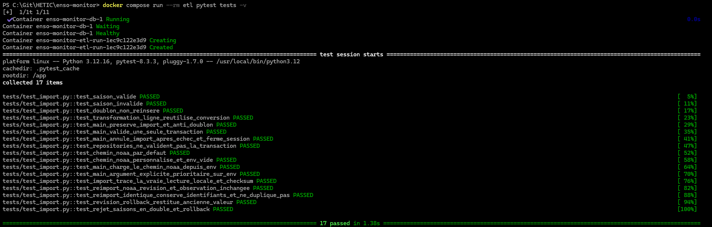
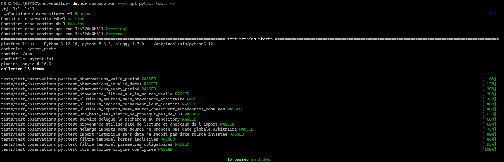
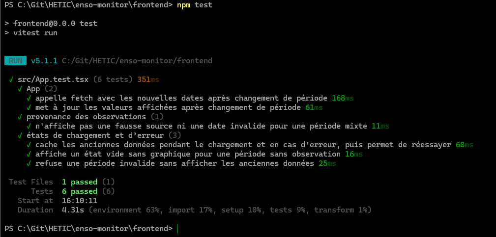

# Tests et vérifications — ENSO Monitor

## Périmètre, exécution et résultats

Depuis la racine du dépôt, dans **PowerShell**, après avoir configuré `.env` :

```powershell
docker compose run --rm etl pytest tests -v
docker compose run --rm api pytest tests -v
cd frontend
npm ci
npm test
npm run lint
npm run build
cd ..
```

| Suite | Nombre de tests constaté le 22/11/2026 | Vérifie notamment |
|---|---:|---|
| ETL / pytest | **17/17** | Conversion, configuration NOAA, réimport, révision, rollback, fermeture de session |
| API / pytest | **15/15** | Dates, HTTP 422, provenance, absence de source, architecture service/repository, CORS |
| React / Vitest | **6/6** | Changement de période, métadonnées mixtes, chargement, erreur/réessai, résultat vide, saisie invalide |

**Total constaté : 38 tests automatisés réussis.** `npm run lint` et `npm run build` ont également réussi lors de cette vérification. Ces chiffres sont un **instantané des exécutions communiquées**, et non une garantie pour une installation future : relancer les commandes pour obtenir le résultat de la version courante.

Les tests Python utilisent **SQLite en mémoire**, avec des fixtures isolées ; ils ne prouvent pas à eux seuls que les migrations ou les accès PostgreSQL fonctionnent. Les tests frontend utilisent des mocks réseau : ils ne prouvent pas à eux seuls l'intégration navigateur/API.

## Nouvelle vérification locale du 22 novembre 2026 (issue #18)

Les commandes ont été **réexécutées sur le code courant** et les sorties de terminal confirment :

| Environnement | Commande | Résultat |
|---|---|---|
| ETL, conteneur Python 3.12 | `docker compose run --rm etl pytest tests -v` | **17 tests réussis**, 2,58 s |
| API, conteneur Python 3.12 | `docker compose run --rm api pytest tests -v` | **15 tests réussis**, 1,94 s |
| Frontend, Windows/Node 25.8.0 | `npm test` | **6 tests réussis** |
| Frontend, Windows/Node 25.8.0 | `npm run lint` et `npm run build` | **Réussis** |
| Frontend, Docker/Node 24 | `npm ci && npm test && npm run lint && npm run build` | **6 tests réussis**, lint et build réussis |

La validation automatisée représente **38 tests distincts** (17 + 15 + 6) ; les 6 tests frontend ont été exécutés deux fois, sans être comptés en double. Une première installation npm sous Windows a échoué sur un verrouillage de fichier natif (`EPERM`), puis a réussi à la nouvelle tentative. Le build Vite rapporte un avertissement non bloquant sur la taille du bundle (636,60 Ko). `npm ci` signale **7 vulnérabilités modérées** : ce signalement requiert une analyse `npm audit` avant toute décision de mise à jour et ne doit pas être confondu avec une vérification de sécurité concluante.

**Preuves visuelles exigées par #18 :** enregistrer trois captures authentiques de la console affichant les lignes récapitulatives `17 passed`, `15 passed` et `Tests 6 passed` dans `docs/screenshots/etl-tests.png`, `docs/screenshots/api-tests.png` et `docs/screenshots/frontend-tests.png`. Les trois captures authentiques sont versionnées dans docs/screenshots/ et intégrées ci-dessous. Ne pas générer de fausses captures à partir de texte recopié.

## Matrice de non-régression

| Risque | Test correspondant | Comportement attendu |
|---|---|---|
| Conversion saison ONI / saison inconnue | `test_saison_valide`, `test_saison_invalide` | Date correcte / valeur rejetée |
| Doublons lors d'un réimport | `test_reimport_identique_conserve_identifiants_et_ne_duplique_pas` | Une observation par `(indice, date)` et liens inchangés si valeur identique |
| Révision NOAA | `test_reimport_noaa_revision_et_observation_inchangee` | Valeur corrigée, pas de doublon |
| Échec après écriture / transaction | `test_main_annule_import_apres_echec_et_ferme_session` | Rollback et session fermée |
| Échec après révision | `test_revision_rollback_restitue_ancienne_valeur` | Ancienne valeur et provenance restaurées |
| Configuration NOAA | `test_chemin_noaa_par_defaut`, `test_main_charge_le_chemin_noaa_depuis_env` | Défaut et chemin configuré respectés |
| Date de lecture et SHA-256 | `test_import_trace_la_vraie_lecture_locale_et_checksum` | Date locale ETL et checksum liés à l'import |
| Source absente | `test_une_base_sans_source_ne_provoque_pas_de_500` | HTTP 200, liste vide, métadonnées nulles |
| Plusieurs provenances | `test_plusieurs_sources_sans_provenance_arbitraire` | Métadonnées propres à chaque observation |
| Filtres temporels et entrées invalides | `test_observations_invalid_dates`, `test_filtre_temporel_bornes_inclusives`, `test_filtre_temporel_parametres_obligatoires` | HTTP 422 pour erreur ; bornes inclusives |
| CORS navigateur | `test_cors_autorise_origine_configuree` | Preflight HTTP 200, origine correcte |
| Changement de période frontend | `App.test.tsx` — « appelle fetch avec les nouvelles dates » et « met à jour les valeurs affichées » | L'URL et la table suivent la période choisie |
| Erreur / rechargement / résultat vide | `App.test.tsx` — groupe « états de chargement et d’erreur » | Pas de données obsolètes, erreur accessible, nouvelle tentative possible |

## Vérifier la pile réelle PostgreSQL / HTTP

Une installation locale complète nécessite Docker Desktop et le fichier NOAA téléchargé dans `./data/oni.data` ; voir le [guide de démarrage](../README.md#démarrer-depuis-un-clone-vierge-powershell--docker-desktop).

```powershell
docker compose config --quiet
docker compose up --build -d
docker compose build etl
docker compose ps
docker compose run --rm api alembic current
docker compose run --rm etl python import_oni.py
Invoke-RestMethod "http://localhost:8000/api/v1/health"
$r = Invoke-RestMethod "http://localhost:8000/api/v1/observations?start=1997-01-01&end=1998-12-31"
$r.observations.Count
```

Attendus : PostgreSQL et API `healthy` ; frontend démarré ; révision Alembic `d0a9b32c5c91 (head)` ; healthcheck `status: ok` ; nombre d'observations strictement positif **après import**. Sur la base de développement vérifiée pour #35, l'API renvoyait **24 observations** pour la fenêtre 1997–1998. Ce n'est **pas un test de création de volume vierge** : pour prouver une installation entièrement neuve, relancer la procédure sur un volume de test distinct, sans supprimer les données de travail.

Tester le CORS réel (en plus du test unitaire) :

```powershell
curl.exe -i -X OPTIONS "http://localhost:8000/api/v1/observations" -H "Origin: http://localhost:5173" -H "Access-Control-Request-Method: GET"
```

Attendu : HTTP 200 et `access-control-allow-origin: http://localhost:5173`.

Ouvrir <http://localhost:5173> : vérifier la courbe, la sélection de dates et les états de chargement/erreur. Les tests automatisés ne remplacent pas cette vérification visuelle et clavier.

## Accessibilité : périmètre de vérification

L'interface utilise notamment un lien d'évitement (« Aller au contenu »), des labels de formulaire, un graphique annoncé avec `role="img"` et `aria-label`, un tableau avec en-têtes et des erreurs `role="alert"`.

Le précédent journal de développement (issue #14) rapporte une navigation au clavier et un contrôle axe DevTools sans problème automatique détecté. Il s'agit d'un **résultat historique**, non d'un audit axe reproduit dans le cadre de #36. Pour la soutenance, refaire une vérification manuelle clavier/focus/lecteur d'écran sur la version actuelle et conserver une capture ou un compte rendu daté.

## Limites de la couverture

- Les tests API et ETL sont isolés sur SQLite ; vérifier PostgreSQL par le parcours HTTP ci-dessus.
- Vitest simule les réponses API ; il ne constitue pas un test E2E navigateur complet.
- Le contrôle de taille du bundle Vite est un avertissement de performance, pas un échec du build.
- Les valeurs ONI récentes sont révisables ; les anciennes valeurs écrasées ne sont pas conservées dans la table `observations` (voir [provenance NOAA](sources-noaa.md)).

## Captures des tests automatisés

### Tests ETL — 17/17



### Tests API — 15/15



### Tests frontend — 6/6


