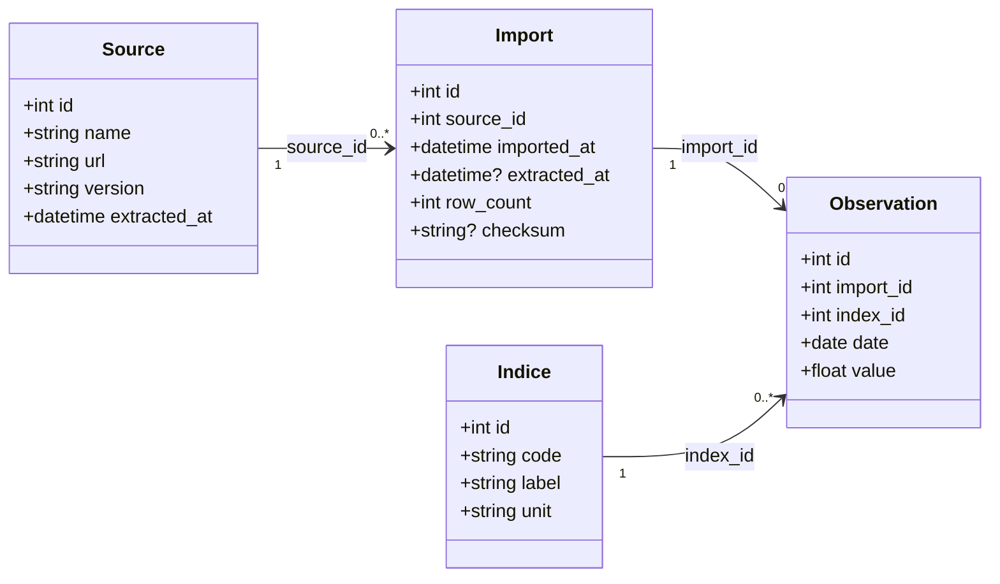

# Diagramme de classes du domaine

**Commentaire (3 phrases).** Une `Observation` contient la date et la valeur ONI, et référence obligatoirement un `Indice` (`index_id`) et un `Import` (`import_id`). Chaque `Import` appartient à une `Source` (`source_id`) ; la provenance exploitable par l'API est donc `Observation → Import → Source`, en plus du lien vers `Indice`. Un `Import` peut avoir **zéro observation** rattachée lorsqu'un fichier identique est réimporté : l'ETL conserve alors le `import_id` des observations inchangées.

**Cardinalités :** les trois clés étrangères sont obligatoires (côté enfant : **1**) ; une source, un indice ou un import peuvent ne posséder aucun enregistrement enfant (**0..***). La contrainte d'unicité SQL `UNIQUE(index_id, date)` empêche deux observations pour le même indice à la même date.

**Portée :** représentation fidèle des colonnes utiles de [`api/app/models.py`](../../api/app/models.py) ; `Import.extracted_at` peut être `NULL` pour les imports historiques, et `Source.extracted_at` ne remplace pas l'horodatage de provenance propre à chaque import.
