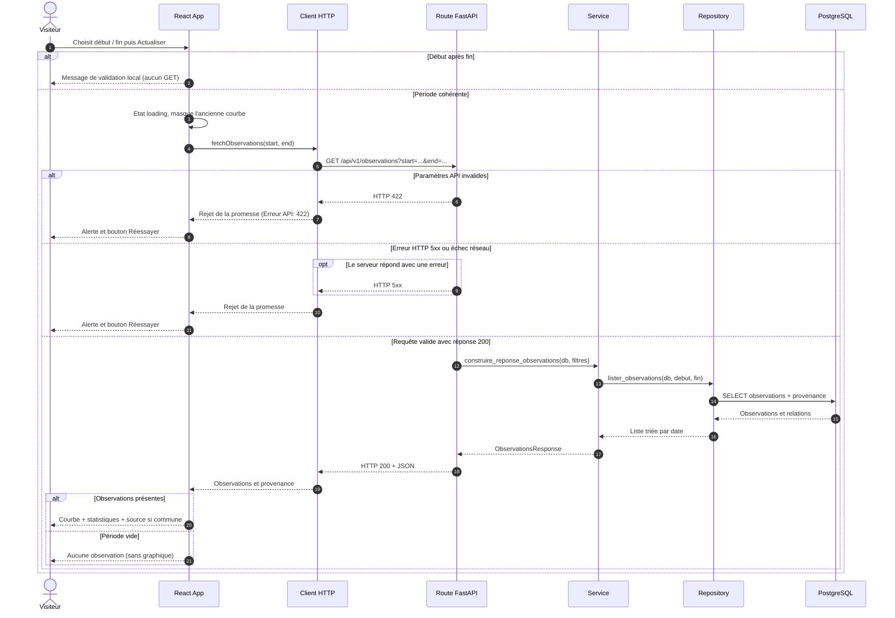

# Diagramme de séquence : consultation du graphique ONI

**Commentaire (3 phrases).** La demande du **Visiteur** traverse le client React, la route FastAPI, le service métier, le repository SQLAlchemy et PostgreSQL ; le service renvoie la provenance par observation. Le frontend rejette une période inversée **sans appel HTTP**, tandis que FastAPI renvoie **422** si les paramètres de l'API sont invalides ; un résultat vide affiche un message sans courbe. En cas d'erreur API/réseau, l'ancienne courbe reste masquée et le Visiteur peut réessayer ; un identifiant de requête empêche aussi une ancienne réponse d'écraser la plus récente.

**Cas justifiés :** les branches représentent les chemins codés dans [`frontend/src/App.tsx`](../../frontend/src/App.tsx), [`frontend/src/api/client.ts`](../../frontend/src/api/client.ts) et [`api/app/routes/observations.py`](../../api/app/routes/observations.py). L'échec HTTP 5xx/réseau est un scénario alternatif à la réponse 200, et non une étape qui la suit.
