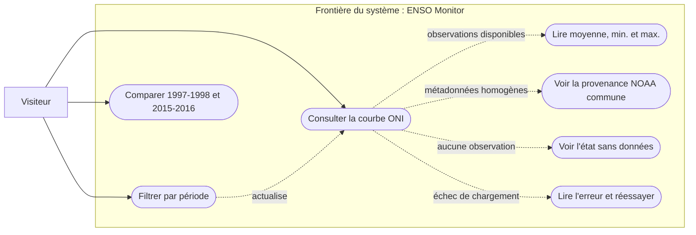

# Diagramme de cas d'utilisation

**Commentaire (3 phrases).** Le **Visiteur** est l'unique acteur utilisateur du MVP ; la zone encadrée représente les fonctions de l'interface ENSO Monitor. Il choisit une période pour consulter la courbe ONI et les statistiques associées, ou utilise la comparaison fixe entre 1997–1998 et 2015–2016. Les sorties conditionnelles justifient les cas : source affichée seulement si les métadonnées sont homogènes, message d'absence si la liste est vide, et alerte avec nouvelle tentative en cas d'erreur.

**Convention :** Mermaid utilise ici `flowchart` pour représenter les cas d'utilisation et la frontière système ; ce n'est pas une notation UML native de cas d'utilisation.
